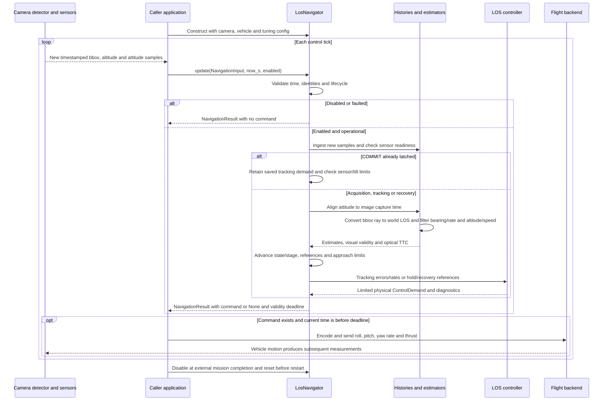

# LOS tracking overview

`los_tracking` is a stateful Python guidance library for an already-airborne
drone approaching one stationary visual target. Each control tick combines a
target bounding box, barometric altitude and attitude to produce physical roll,
pitch, yaw-rate and collective-thrust demands.

The caller owns image detection, takeoff, target search, arming, flight modes and
command transport. The library runs synchronously through
`LosNavigator.update()` and opens no devices or connections.

## Core idea

The target's image position defines a camera ray. The library uses camera
calibration, camera mounting orientation and **attitude at image capture time**
to rotate that ray into a world line of sight (LOS). This compensates for image
motion caused by the drone rotating. A filter estimates bearing and angular
rate; a separate barometer filter estimates altitude and vertical speed.

After several consistent target observations, the navigator retains the acquired
azimuth and initial heading. During tracking:

- Roll corrects azimuth error and azimuth rate.
- Vertical motion corrects elevation error and elevation rate relative to
  `tuning.track_elevation_rad` (default `0`, a horizontal world LOS).
- Pitch provides the configured forward approach, reduced when control authority
  or descent feasibility is limited.
- Yaw rate holds the initial heading.

The controller applies angle, combined-tilt, vertical-speed, thrust and slew
limits. Apparent bbox growth provides an optical time-to-contact (TTC) estimate
to supervise the approach. TTC is a model-based estimate, not measured range or
a collision notification.

## Required inputs

Construct `LosNavigator(config)` with a `NavigatorConfig`: calibrated image
dimensions and intrinsics, camera-to-body mounting quaternion, vehicle mass and
thrust authority, target altitude in the barometer's datum, and controller,
timing and acceptance limits. See the
[example profile](../examples/bullet_profile.yaml) and
[parameter guide](package-parameters.md).

Call `navigator.update(inputs, now_s=..., enabled=...)` on each control tick:

| Input | Data and meaning |
| --- | --- |
| `NavigationInput.target` | `TargetObservation(stream_id, sequence, timestamp_s, bbox)`. Bbox is `(x, y, width, height)` in calibrated image pixels; a new observation with `bbox=None` explicitly means no target was detected. |
| `NavigationInput.barometer` | `BarometerSample(stream_id, sequence, timestamp_s, altitude_m)`. Altitude in metres, positive up, in the same datum as configured target altitude. |
| `NavigationInput.attitude` | `AttitudeSample(stream_id, sequence, timestamp_s, orientation_xyzw)`. Unit body-to-world quaternion in XYZW order. Body axes are forward/left/up; world Z is up. |
| `now_s` | Current control time in seconds, strictly increasing between updates and in the same clock domain as all measurement timestamps. |
| `enabled` | Boolean authorizing navigation. It does not arm the drone. |
| `command_horizon_s` | Optional nonnegative scheduling/delivery allowance, default `0`. Rejects an accepted image before its remaining freshness is too short for this horizon. It does not extend command validity. |

The three sample fields are independently optional on any tick: `None` means
there is no new sample and does not refresh old data. Each sample carries its
measurement time and a `(stream_id, sequence)` identity. Duplicates do not advance
filters or acquisition dwell; older samples are ignored. A changed stream
requires reset. Invalid inputs or clocks raise `ValueError`.

Use image capture timestamps and undistorted coordinates matching the calibration.
Image X increases right and Y down. Attitude history interpolates to capture time
without extrapolation; an image can wait for a later attitude sample within its
freshness limit. No raw image, horizontal position/velocity or metric target
range is required. Use one owner thread for each navigator.

## Navigation states

| State | Meaning and command behavior |
| --- | --- |
| `DISABLED` | No command. First enable after construction/reset starts acquisition. Disabling an active mission ends that session; reset before enabling again. |
| `ACQUIRE` | Warm up altitude estimation and qualify the target using at least three accepted frames spanning the acquisition dwell. Once sensors are ready, altitude/heading hold commands can be available before tracking starts. |
| `TRACK` | Apply LOS guidance using the acquired azimuth and configured elevation reference. Estimate TTC and supervise control limits and descent feasibility. |
| `RECOVER` | Capture recovery-entry altitude, reduce forward approach and attempt target reacquisition within a timeout. Bounded extrapolated LOS correction may continue; measured over-tilt uses hold behavior. Reacquisition preserves the original azimuth and heading. |
| `COMMIT` | A fresh, sufficiently large bbox reaching the configured image-edge margin can latch the last tracking demand from `TRACK`, or from `RECOVER` caused by persistent limitation. Further visual updates are ignored and the saved demand is reissued while enabled and required sensors remain valid. Measured over-tilt faults. |
| `FAULT` | Latched failure with no command, including required sensor loss after readiness, stream changes, excessive control gaps, numeric failures or acquisition/recovery timeout. Call `reset()` to start a new session. |

Ordinary visual loss or rejection during tracking enters recovery unless the
close-target commit condition has already taken precedence. `COMMIT` does not
infer contact or completion; the caller must end navigation externally.

`TrackStage` is separate from the navigation state: `BEARING` is the initial TTC
stage, `TTC` requires a qualified estimate and entry dwell, and `TERMINAL` latches
when qualified TTC crosses the terminal threshold. These stages supervise the
same LOS controller; `TERMINAL` alone does not mean `COMMIT` or mission completion.

## Outputs and caller responsibilities

Each update returns a `NavigationResult`:

| Output | Meaning |
| --- | --- |
| `state`, `stage`, `reason` | Navigation lifecycle, TTC stage and machine-readable status or failure cause. |
| `command` | `ControlDemand` with `roll_rad`, `pitch_rad`, `yaw_rate_rad_s` (body-Z rate) and `thrust_n` (collective newtons), or `None` when unavailable. |
| `generated_at_s`, `valid_until_s`, `sequence` | Result time, command-use deadline and increasing result identity. |
| `diagnostics` | Bearing/rate estimates and validity flags, reference bearing, altitude/vertical speed, TTC qualification, sensor ages, visual rejections and control limits. |
| `usable` | True when `command` exists. The caller must separately check the current time against `valid_until_s`. |

Apply a command only while `result.usable` and the current time is strictly less
than `result.valid_until_s`. Deadlines include command lifetime, sensor freshness
and applicable image/state deadlines. Even in `COMMIT`, each reissued result has
a new, bounded validity deadline and requires fresh attitude/barometer data.

The caller converts physical demands into its flight backend's encoding and
enforces command expiry with a receiver watchdog. Warmup, disabled and fault
results can contain no command; the caller owns stabilization and mission policy
when guidance is unavailable. The library does not report collision or stop
horizontal motion merely by requesting level pitch.

## Overview sequence

The first calls normally warm up sensors and acquire the target before tracking.
A newly eligible close-target observation can enter `COMMIT` before ordinary
visual processing, using the previously saved tracking demand.

## Further reading

- [Package control flow](package-control-flow.md): detailed update pipeline.
- [Image-to-bbox data flow](image-to-bbox-data-flow.md): upstream image processing.
- [Approach walkthrough](approach-walkthrough.md): worked explanations.
- [Public data contracts](../src/los_tracking/types.py) and
  [navigator implementation](../src/los_tracking/navigator.py): current behavior.
- [Library README](../README.md): calling example and optional
  `AltitudeHeadingHold` / `ControlHandoff` integration before navigation.
